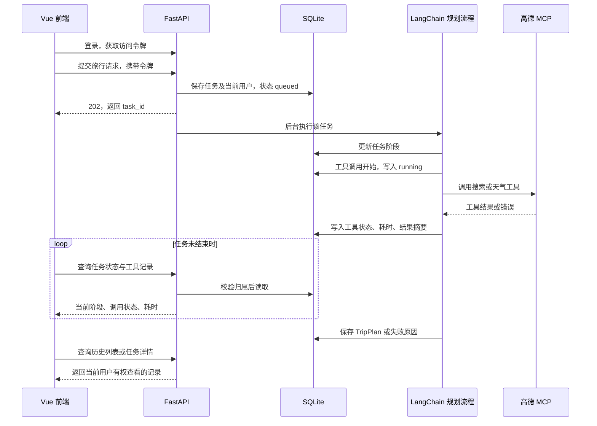

# 智能旅行助手二次开发计划

编写日期：2026-09-28  
适用项目：当前 `helloagents-trip-planner` 原项目  
初始计划交付（2026-09-28）：只新增本计划，不修改业务代码。
实施进度（2026-09-30）：第 1–9 步已全部完成，验证结果与源码行号见 [二次开发变更记录](docs/二次开发变更记录.md)，最终场景证据见 [最终验收记录](docs/最终验收记录.md)。

## 1. 目标与实施原则

本轮二次开发围绕三个目标：

1. 用 **LangChain 替换 HelloAgents**，保留景点、天气、酒店、行程规划四个职责。
2. 记录真实工具调用的状态、耗时和错误，在页面中查看执行过程及历史记录。
3. 增加注册、登录、用户数据隔离，登录后能查看历史规划和结果详情。

以“代码简洁、原项目渐进改造、每一步可运行”为原则。先完成可学习、可演示的版本，不一次重写整个项目。保留现有表单、结果页、地图、编辑及导出功能，主要调整数据来源和后端执行方式。

### 已确认范围与技术默认方案

- 框架：直接使用 LangChain；四阶段仍由 Python 顺序编排，第一版不手写 LangGraph 图。LangChain Agent 底层可能依赖 LangGraph，这不等于项目需要额外编写图工作流。
- 登录：本地用户名和密码注册登录，不接短信、邮箱验证码或第三方登录。
- 数据库：SQLite 文件数据库，不要求另装 MySQL、PostgreSQL 或 Redis。
- “后台”：同一个 Vue 应用里的轻量管理员页面；管理员查看所有规划任务，普通用户查看自己的任务和历史。
- 过程展示：执行中约每秒轮询一次任务详情，完成后仍可回看。不引入 SSE、WebSocket 或额外监控平台。
- 运行方式：本地单后端进程、单 worker；任务在 FastAPI 进程内执行。

用户已确认：采用管理员查看全部任务、普通用户查看本人历史的权限范围；执行过程中更新工具状态和耗时，结束后可以回看。数据库、登录方式和轮询实现采用本计划给出的简洁默认方案。

## 2. 当前代码实际情况

| 模块 | 当前实现 | 改造时的注意点 |
| --- | --- | --- |
| Agent 编排 | `backend/app/agents/trip_planner_agent.py` 中依次调用四个 `SimpleAgent` | 保留顺序，先迁移框架；不同时增加并行调度 |
| 模型接入 | `services/llm_service.py` 创建 `HelloAgentsLLM` | 新模型客户端需要显式传入模型名、地址、密钥及超时 |
| MCP 接入 | Agent 文件和 `services/amap_service.py` 分别创建 HelloAgents `MCPTool` | 两处都要迁移，不能只改 Agent 后就删除旧依赖 |
| API | `api/routes/trip.py` 的 `async` 接口直接调用同步规划函数 | 必须改成真正异步调用，避免规划时无法及时查询状态 |
| 模型输出 | 截取 JSON 文本后执行 `TripPlan(**data)` | 保留 Pydantic 模型，改进输出适配与错误分类 |
| 失败处理 | 异常时生成占位景点、固定规律坐标，路由仍可能返回成功 | 新版取消这类“占位成功”，明确区分成功、降级、失败 |
| 历史记录 | `Home.vue` 和 `Result.vue` 仅使用 `sessionStorage.tripPlan` | 改成数据库保存、通过任务 ID 查询 |
| 编辑保存 | `Result.vue` 的“保存修改”也只写浏览器缓存 | 必须同时改为后端保存，保证刷新和重新登录后仍可读取 |
| 前端进度 | `Home.vue` 使用定时器模拟进度 | 替换成真实任务阶段及工具状态，不把模拟百分比作为执行证据 |
| 路由 | Vue 路由直接定义在 `frontend/src/main.ts` | 先在原文件扩展，避免为了目录形式增加无必要重构 |

另外有三处迁移时一起处理的小问题：

- 旅行健康检查读取了不存在的 `agent.agent`；地图健康检查直接读取 MCP 私有属性，需要改成新服务的公开状态。
- `AmapService` 的搜索、天气、路线、地理编码部分仍有 TODO 和固定空返回。客户端迁移不代表这些接口已能正确返回数据，需补齐原接口所需的最小解析。
- 图片服务直接导入 `requests`，但依赖文件没有显式声明。移除 HelloAgents 时补齐此直接依赖；同步图片请求通过线程池调用，避免阻塞状态查询。

## 3. 推荐技术与使用方式

| 能力 | 技术选择 | 选择理由 |
| --- | --- | --- |
| Agent | LangChain `create_agent`、`ainvoke` | 与原来的“角色提示词＋模型＋工具”容易对应 |
| LLM | `langchain-openai` 的 `ChatOpenAI` | 接入兼容 OpenAI 协议的现有模型服务；先验证当前模型的工具调用能力 |
| MCP | `langchain-mcp-adapters`，保留 `uvx amap-mcp-server` | 复用已有高德 MCP 服务，只替换客户端适配层 |
| 数据模型 | 现有 Pydantic `TripRequest`、`TripPlan` | 继续作为前后端的数据边界，减少前端改动 |
| 持久化 | SQLite＋SQLAlchemy 2.x | 只需一个数据库文件，用少量 ORM 模型表达用户、任务和调用记录 |
| 密码与令牌 | `pwdlib[argon2]`＋`PyJWT`＋FastAPI `HTTPBearer` | 密码保存哈希，接口通过 Bearer Token 获取当前用户 |
| 后台执行 | FastAPI `BackgroundTasks`＋异步规划函数 | 提交任务后立即返回任务 ID，不新增队列服务 |
| 前端 | 现有 Vue 3、TypeScript、Ant Design Vue、Axios | 继续使用已有技术栈和组件 |
| 测试 | pytest、pytest-asyncio、httpx；前端现有构建命令 | 重点测试接口、工具失败、用户隔离和历史持久化 |

### 依赖版本策略

实施第 1 步时，在独立开发环境验证兼容的依赖组合，执行 `pip check`，再锁定实际验证通过的版本。不要直接把所有依赖升级为最新版，也不要删除当前可运行环境。

本计划采用官方适配器仓库中的 `MultiServerMCPClient`／`load_mcp_tools` 接口。官方最新文档还提供了处于 beta 的 `langchain.mcp.MCPAdapter`；第一版不混用两套接口。MCP 的错误返回行为需要按最终锁定版本实测。[MCP 适配器官方仓库](https://github.com/langchain-ai/langchain-mcp-adapters)、[当前 MCP 文档](https://docs.langchain.com/oss/python/langchain/mcp)

## 4. 改造后的请求流程



四个角色继续按“景点 → 天气 → 酒店 → 行程”执行。LangChain 负责每个角色内部的模型与工具交互，Python 负责角色之间的顺序；先让数据流容易理解，再考虑并行优化。

## 5. 关键设计约定

### 5.1 LangChain 与 MCP

- 保留四份业务职责提示词，删除 HelloAgents 专用的 `[TOOL_CALL:...]` 文本协议。
- 使用 MCP 实际发现的工具名称和参数定义，不机械保留 `amap_` 前缀。
- 景点、酒店角色只绑定检索所需工具；天气角色只绑定天气工具；规划角色不绑定外部查询工具。
- 四个角色通过 `create_agent` 创建。前三个从返回消息中取得回答，规划角色通过 `ToolStrategy(TripPlan, handle_errors=False)` 取得 `structured_response`；输出校验重试由外层统一控制。
- 每个规划任务使用独立的消息、Agent 运行状态和工具监控上下文。允许共享无用户状态的模型客户端，不能把上一位用户的对话历史传给下一位用户。
- 一个任务在自己的异步上下文内建立 MCP 会话，复用该会话完成工具查询，任务结束后关闭。独立地图接口按请求管理会话，不跨事件循环缓存已打开的连接。
- 第一阶段验证模型确实支持标准工具调用和所选结构化输出方式；不支持时明确记录为模型兼容问题，不静默退回旧文本协议。

LangChain Agent 的调用结果包含消息或结构化结果，不再等同于 HelloAgents 的字符串返回值，必须做显式转换。[Agent 官方文档](https://docs.langchain.com/oss/python/langchain/agents)、[结构化输出文档](https://docs.langchain.com/oss/python/langchain/structured-output)

### 5.2 工具监控记录什么

监控放在**真正执行 MCP 工具的统一包装层**，保留原工具名和参数 schema。该层对 Agent 使用的工具和独立地图服务复用同一套执行规则，避免每个 Agent 各写一份计时代码。

每次真实调用独立记录：

| 字段 | 含义 |
| --- | --- |
| `task_id` | 所属规划任务；独立地图接口调用可不关联任务，第一版不进入规划后台列表 |
| `agent_name`、`tool_name` | 哪个角色调用哪个工具 |
| `status` | `running`、`succeeded`、`empty`、`failed` |
| `started_at`、`finished_at` | UTC 开始、结束时间，前端按本地时区展示 |
| `duration_ms` | 使用单调时钟 `time.perf_counter()` 计算的实际耗时 |
| `input_summary`、`output_summary` | 脱敏参数及结果摘要，摘要限制长度，不保存密钥或授权头 |
| `error_code`、`error_message` | 可区分超时、连接问题、工具执行错误等情况 |

具体规则：

1. 调用前提交 `running` 记录，不能等整个规划结束才写日志。
2. 调用完成后检查实际结果，再写终态；无匹配 POI 等业务空结果记为 `empty`。
3. 异常、MCP `isError`、工具消息错误状态、高德业务错误均不能记成成功。优先将适配器配置为执行错误抛异常，再补充业务返回值检查。
4. 返回格式无法识别时记为错误，不凭“没有抛异常”判断成功。
5. 通过统一包装层记录真实 MCP 调用；结构化输出使用的 schema 工具不当作高德查询写入监控。
6. 工具从未执行时，页面不能伪造一条成功记录。查询角色没有有效工具结果时，按该阶段的信息缺失规则处理。
7. 同一个工具被再次调用，就新增一条记录。一次工具失败后成功补查，可以最终生成成功任务，失败调用记录仍保留。
8. 工具耗时只表示工具执行时长，任务总耗时还包括模型生成、连接初始化等时间，不能直接把两者画等号。
9. 调用仍在运行时，前端根据开始时间显示持续变化的“已用时间”；结束后以服务端记录的 `duration_ms` 为准，不把运行中的估计值当作最终耗时。

第一版用工具包装函数实现，不同时叠加复杂 callback 系统、LangSmith 和多个日志写入入口。

### 5.3 任务状态与兜底

任务状态固定为：`queued → running → succeeded / degraded / failed`。

| 场景 | 处理方式 |
| --- | --- |
| 获取有效资料且输出通过校验 | `succeeded`，保存 `TripPlan` |
| 天气不可用，其他信息足够生成计划 | 天气列表为空，附原因说明，任务 `degraded` |
| 酒店不可用，其他信息足够生成计划 | 推荐酒店置空，附原因说明，任务 `degraded` |
| 未获得有效景点信息、模型服务不可用 | `failed`，返回明确原因，不生成虚构景点填充结果 |
| 模型输出格式不合法 | 将校验错误反馈给规划角色，最多额外修复一次；仍失败则 `failed` |
| 查询日期超出实际可获得的天气范围 | 保留实际可用日期，提示缺失，不能补写虚构天气 |
| 服务重启中断任务 | 标记为 `failed`，错误码 `SERVICE_RESTARTED`，用户可重新提交 |

保留 `TripPlan` 的现有主要字段；在内部增加简单的 `PlanningResult`，包含 `plan`、`status`、`warnings`。由接口和任务服务负责转换，不把账号或工具日志塞进行程模型。

初始限制：单工具执行超时 30 秒、单模型请求超时 90 秒、整次规划超时 600 秒；每个查询角色最多执行 3 次真实 MCP 调用，JSON 修复最多 1 次。超时与次数上限放入配置，超过上限时结束该阶段，避免无限循环。

第一版不做多层自动重试，模型客户端显式设置 `max_retries=0`；格式修复由规划流程统一控制。再次规划由用户明确触发，并生成新任务 ID。工具日志记录实际发生的每次调用，不能被自动重试掩盖。

### 5.4 用户认证与权限

- 用户名和密码注册登录；用户名统一去首尾空格并转小写，长度 3–32，仅允许字母、数字、下划线；密码长度 8–128，不擅自去空格。
- 密码仅保存 Argon2 哈希，使用 PyJWT 签发 JWT。令牌 `sub` 为用户 ID，设置 2 小时有效期，服务端固定算法校验签名和有效期。
- JWT 密钥通过本项目环境变量配置，无默认可用密钥。公开示例只放占位值。
- 前端第一版将访问令牌保存在 `sessionStorage`，Axios 统一附带 `Authorization: Bearer ...`；401 时清理登录及旧结果缓存，跳转登录页。
- 第一版不做 refresh token；退出登录删除本地令牌，已签发令牌在到期前仍可能有效。演示环境之外的部署再单独完善令牌撤销方案。
- 注册接口不接受管理员身份。管理员通过本地 `create_admin.py` 命令创建，密码用交互输入，不硬编码默认账号密码。
- 用户任务列表、详情、工具记录及结果保存均在后端校验归属；普通用户访问他人的任务统一返回 404。
- 管理接口单独检查数据库中的管理员身份；普通用户直接调用管理接口返回 403。管理员第一版仅查看，不修改他人的行程。
- 有费用或外部服务调用的旧规划、地图、POI 接口也要求登录；健康检查保持公开且不返回敏感配置。
- 原结果页中拼接外部文本的地图信息窗口改为安全 DOM 文本或转义输出，避免登录令牌引入后仍保留可执行外部 HTML 的位置。

密码哈希与 JWT 的技术选择参考 FastAPI 官方认证示例；本项目采用 JSON 登录请求和 `HTTPBearer`，不要求前端改成 OAuth2 表单。[FastAPI 认证文档](https://fastapi.tiangolo.com/tutorial/security/oauth2-jwt/)

### 5.5 数据库只保留三张业务表

数据库文件固定为 `backend/data/trip_planner.db`，路径相对于后端目录解析，避免启动目录变化产生多个数据库。数据文件加入忽略规则。

| 表 | 主要字段 |
| --- | --- |
| `users` | 整数主键、唯一用户名、密码哈希、`is_admin`、创建时间 |
| `trip_tasks` | UUID 任务 ID、用户外键、状态、当前阶段、请求 JSON、原始计划 JSON、编辑后计划 JSON、警告列表、错误码与错误摘要、创建/开始/完成/更新时间、总耗时 |
| `tool_calls` | 自增主键、任务外键、Agent 名、工具名、状态、参数与结果摘要、错误信息、开始/完成时间、耗时 |

说明：

- 用 JSON 字段保存 `TripRequest` 和 `TripPlan`，第一版不把每天、酒店、景点拆成许多表。
- 历史查询默认按创建时间倒序，支持状态筛选和分页；默认每页 20 条，上限 100 条。
- 工具记录按记录 ID 排序；因调用次数有限，第一版直接附在任务详情中，不额外做日志分页系统。
- 三张表在数据库步骤一次建好；开启 SQLite 外键和 WAL，索引覆盖用户历史与任务工具记录查询。
- SQLAlchemy Session 按操作创建和关闭，不将请求的 Session 或 ORM 对象传给后台任务。后台只接收 `task_id`。
- 数据库写入采用短事务，不在等待模型或 MCP 的过程中持有事务。后台异步流程里的同步数据库操作通过线程池执行。
- 第一版在空数据库上 `create_all()`；后续若改表结构，另写显式迁移，不用删除数据库的方式“更新表”。

SQLite 的事务和并发行为需按短事务方式使用，本轮定位为单进程学习版本。[SQLAlchemy SQLite 文档](https://docs.sqlalchemy.org/en/20/dialects/sqlite.html)

### 5.6 后台任务与页面恢复

`POST /api/trip/tasks` 先提交数据库记录，再安排 `BackgroundTasks` 执行，立即返回 202。任务函数内部真正 `await` LangChain 和 MCP 调用，不使用“async 函数内直接调用耗时同步方法”的写法。

只启动一个后端 worker。启动时将上次遗留的 `queued/running` 任务及 `running` 工具记录标记为中断失败；不能自动重放，以免重复调用模型。重启后无法精确确定的工具耗时置空，不伪造成正常耗时。热重载也可能中断任务，应在演示时关闭 reload。

前端使用“本次查询完成后等待约 1 秒再查询”的轮询方式，避免 `setInterval` 叠加请求。进入终态、401、无权限或页面卸载时停止；临时网络失败最多重试 3 次，再显示手动刷新入口，不把断网误判为任务失败。

`BackgroundTasks` 是进程内执行机制，不是可靠消息队列。当前方案用持久化状态和重启标记让中断可见，暂不承诺断点续跑、多进程分发或生产级队列可靠性。[FastAPI BackgroundTasks 文档](https://fastapi.tiangolo.com/tutorial/background-tasks/)

## 6. 接口与页面约定

### 后端接口

| 接口 | 用途 | 权限 |
| --- | --- | --- |
| `POST /api/auth/register` | 注册用户名和密码，返回公开用户信息，不返回密码哈希 | 公开 |
| `POST /api/auth/login` | 返回 `access_token`、`token_type`、`expires_in` 和公开用户信息 | 公开 |
| `GET /api/auth/me` | 恢复当前登录身份 | 已登录 |
| `POST /api/trip/tasks` | 接收原 `TripRequest`，返回 202 和 `{task_id, status}` | 已登录 |
| `GET /api/trip/tasks` | 当前用户任务历史，支持 `page/page_size/status` | 已登录、仅本人 |
| `GET /api/trip/tasks/{task_id}` | 状态、阶段、请求、计划、警告、错误及工具记录 | 已登录、仅本人 |
| `PATCH /api/trip/tasks/{task_id}/result` | 保存现有结果页的行程编辑，返回更新后的详情 | 已登录、仅本人 |
| `GET /api/admin/tasks` | 所有用户的任务列表，支持状态筛选和分页 | 管理员 |
| `GET /api/admin/tasks/{task_id}` | 只读查看任务结果与调用记录 | 管理员 |
| `POST /api/trip/plan` | 保留旧同步等待式接口，内部复用同一任务执行核心 | 改造后要求登录 |

兼容与错误约定：

- 不把旧 `/api/trip/plan` 偷换成 202；其 `success/message/data` 外层结构保留，可追加 `task_id/status/warnings`。它也创建历史和调用记录，只是等待执行完成再返回。
- 新任务详情顶层明确包含 `task_id/status/stage/request/plan/warnings/error/tool_calls` 及时间信息；`plan` 可为空，`error` 使用 `{code, message}`。
- 列表统一返回 `items/total/page/page_size`。失败任务也出现在历史中，以便回看失败原因。
- 请求字段错误返回 422；用户名重复返回 409；认证失效返回 401；普通用户调用管理员接口返回 403；本人查询不到的任务返回 404。
- 旧等待式接口外部依赖失败返回 502、规划超时返回 504；新后台接口在提交后通过任务的 `failed` 状态表达执行失败，状态查询本身仍正常返回 200。
- 历史结果编辑仅允许 `succeeded/degraded` 任务，按 `TripPlan` 校验，并保持城市、日期及天数与原任务一致。运行中任务不能编辑，返回 409。
- 保留原始生成结果，编辑保存到单独 JSON 字段；详情优先返回编辑版。工具记录对应原始生成过程，不因为手动编辑伪造新调用。
- 删除景点后重算门票合计和总预算，其他分类费用保留；不存在预算时不强行生成预算。

### 前端页面

| 路由 | 页面 | 说明 |
| --- | --- | --- |
| `/login` | `Login.vue` | 同一页面提供登录、注册两个模式 |
| `/` | 原 `Home.vue` | 保留表单，改为提交任务 |
| `/result/:taskId` | 原 `Result.vue` | 运行中展示阶段和工具状态；完成后复用原行程展示 |
| `/history` | `History.vue` | 本人历史任务、状态、时间、详情入口 |
| `/admin/tasks` | `AdminTasks.vue` | 管理员任务列表，选择记录后查看工具调用明细 |

调用记录使用一个可复用的 `ToolCallTable.vue`，供结果页和管理员页面使用。登录状态使用简单的 Vue 响应式模块，不为了三个页面新增 Pinia 等状态库。

旧 `/result` 重定向到历史页；旧 `sessionStorage.tripPlan` 不自动绑定到任何账号。图片请求也统一走现有 Axios 客户端，移除结果页中硬编码的后端地址，使鉴权与 API 地址配置一致。

## 7. 分步实施清单

每一步单独交付。后续开始实施时，默认只执行用户指定的步骤，完成后说明本步改动和验证结果，不连续重写全部模块。

步骤 1–6 为本机分阶段联调版本，旧业务入口的鉴权尚未全部启用；第 7 步完成前不作为对外发布版本。

| 步骤 | 本步结束后应达到的状态 |
| --- | --- |
| 1（已完成） | 新 LangChain/MCP 接入已验证，原入口保留，新旧环境启动通过 |
| 2（已完成） | 原规划接口异步使用 LangChain，真实规划联调通过，失败与降级可区分 |
| 3（已完成） | 外围接口完成异步迁移，移除运行时 HelloAgents 依赖；地图、图片及完整规划真实联调通过 |
| 4（已完成） | 三张 SQLite 业务表已建立，注册、登录、当前用户、管理员创建及权限依赖可用 |
| 5（已完成） | 规划任务可以持久化、查询及恢复查看 |
| 6（已完成） | 工具开始、结束、空结果和失败可真实记录 |
| 7（已完成） | 用户可从前端登录、生成、查看和保存历史行程 |
| 8（已完成） | 管理员可查看所有任务及工具调用过程 |
| 9（已完成） | 完成异常场景与隔离测试，补齐运行和学习说明 |

### 第 1 步：建立新框架接入底座

**修改：** `backend/requirements.txt`、`backend/app/services/llm_service.py`、`backend/app/config.py`、`backend/.env.example`。  
**新增：** `backend/app/services/mcp_service.py`、`backend/tests/test_mcp_service.py`、`backend/requirements-dev.txt`、`docs/二次开发变更记录.md`。  
**实施时补充：** `backend/tests/conftest.py`（测试隔离配置）、`backend/tests/test_llm_service.py`（模型协议与结构化输出测试）、`backend/scripts/check_integrations.py`（独立真实联调入口）、`backend/requirements-lock.txt`（已验证开发环境快照）。
**删除：** 本步不删除旧运行入口和 HelloAgents 依赖。

- 增加 LangChain、模型适配器、MCP 适配器依赖；在 `llm_service.py` 增加新模型工厂，暂保留旧工厂供现有功能运行。
- 明确配置优先级：显式 `LLM_API_KEY/LLM_BASE_URL/LLM_MODEL_ID` 优先，兼容现有 `OPENAI_API_KEY/OPENAI_BASE_URL/OPENAI_MODEL`；密钥不打印。
- 新增统一 MCP 会话与工具加载入口，保留已有 `uvx amap-mcp-server` 启动方式。
- 验证工具发现、实际参数 schema、单次工具查询、模型标准工具调用及 `TripPlan` 结构化输出兼容性，再锁定依赖版本。

**验收：** 原前后端仍能启动；新入口能发现搜索和天气工具；模拟测试可在无外部密钥时运行。真实模型/高德联调单独执行，不纳入普通自动测试。

**要理解：** 模型客户端、Agent、MCP 服务端分别负责什么；为什么“替换框架”不是只改导入名。

### 第 2 步：替换四个 Agent 和行程输出

**修改：** `backend/app/agents/trip_planner_agent.py`、`backend/app/services/mcp_service.py`、`backend/app/api/routes/trip.py`、`backend/app/models/schemas.py`。  
**新增：** `backend/tests/test_trip_planner.py`。  
**实施时补充：** 更新 `config.py`、`.env.example` 的次数与超时配置，以及 `llm_service.py` 的迁移说明；扩充 MCP 测试，新增 schema、API、真实 LangChain 运行时的离线测试和 `scripts/check_trip_api.py` 真实联调入口。
**删除：** Agent 文件里的 `SimpleAgent/MCPTool` 使用、旧 `[TOOL_CALL:...]` 指令、手写 JSON 代码块截取及虚构占位计划逻辑。

- 用 LangChain 重新创建四个角色，继续顺序调用，采用任务内独立上下文。
- 按实际高德 MCP 协议，景点和酒店使用“搜索 → POI 详情”取得真实坐标；天气兼容服务端扁平预报。搜索、详情合计遵守每阶段 3 次上限，查询城市由请求固定。
- 本步先完成 MCP 错误、业务错误与空结果分类，在任务内存上下文中保存实际工具结果、调用次数和阶段成功标志，供输出与降级判断使用；不依赖尚未建立的数据库监控表，第 6 步再接入持久化日志。
- 将规划函数改为异步，API 使用 `await` 调用；从消息和 `structured_response` 取得结果。
- 实现 `PlanningResult`、明确的失败和降级处理、输出一次修复上限，保留外层 `TripPlanResponse` 兼容结构。
- 补充日期和天数一致性校验，以及生成结果的日期、天数与原请求一致性检查。
- 修正旅行健康检查，不依赖不存在的 `agent.agent`，不为健康检查请求实际生成行程。

**验收：** 原首页通过旧接口仍可生成并展示结果；模型输出错误会明确失败；天气缺失会标记降级，而不是生成示例天气。

**要理解：** 一次 `ainvoke()` 的返回结构；前三个角色如何把结果交给规划角色；`TripPlan` 在哪里产生。

### 第 3 步：迁移外围 MCP 接口并移除旧框架

**修改：** `backend/app/services/amap_service.py`、`backend/app/api/routes/map.py`、`backend/app/api/routes/poi.py`、`backend/app/services/llm_service.py`、`backend/app/config.py`、`backend/requirements.txt`；同步调整 `README.md` 与 `frontend/src/App.vue` 的项目标识。  
**新增：** `backend/tests/test_map_api.py`。  
**实施时补充：** 共享 MCP 执行/错误转换、外围服务统一异常响应、路线字段校验与地理编码 API；新增 `scripts/run_amap_mcp.py` 处理外部服务的 stdio 调试输出，新增 `scripts/check_map_api.py`、配置和启动适配测试。更新依赖锁定文件、前后端配置示例及浏览器标题；保持真实 `.env` 不变。
**删除：** 旧模型工厂、HelloAgents 专用 MCP 单例、读取相邻 `HelloAgents/.env` 的逻辑，以及确认已无调用的旧依赖。

- 将搜索、天气、路线、地理编码、POI 详情统一接到新 MCP 服务；按原响应模型补齐必要返回解析，移除固定空返回占位。
- 完成对应 API 的异步适配和地图健康检查；工具不可用时明确返回错误。
- 保留图片功能，显式声明 `requests`，在图片路由用线程池执行现有同步调用。
- 按真实 MCP 协议补齐搜索结果的详情坐标，每次最多 5 条，默认间隔 0.4 秒；限频仍明确返回错误，不自动重试。公交距离按服务端提供的起终点距离说明。
- 实测发现 0.1.11 公交工具的调试 `print` 污染 stdout；使用独立环境中的轻量入口屏蔽该模块调试打印，并指定 UTF-8，不修改第三方安装包。
- 所需配置写入本项目自己的环境配置；只修改示例文件中的占位说明，不覆盖用户现有密钥。
- 全仓确认业务代码已无 HelloAgents 导入后再删除依赖。原教程作为学习资料保留，不批量删除其中的历史代码示例。

**验收：** 新环境安装后能够启动；规划、地图、POI、图片接口分别有可验证结果；普通空搜索与外部服务错误可区分。

**要理解：** 主规划流程与独立地图接口为什么需要共同迁移；统一 MCP 服务如何减少重复代码。

### 第 4 步：数据库与认证后端

**新增：** `backend/app/database.py`、`backend/app/models/entities.py`、`backend/app/services/auth_service.py`、`backend/app/api/deps.py`、`backend/app/api/routes/auth.py`、`backend/scripts/create_admin.py`、`backend/tests/test_auth.py`。  
**修改：** `backend/app/api/main.py`、`backend/app/models/schemas.py`、`backend/app/config.py`、`backend/requirements.txt`、`backend/.env.example`、`backend/.gitignore`。  
**删除：** 无。

**实施时补充：** 更新完整依赖锁与 README；数据库测试同时验证三张表、索引、外键和 WAL，认证测试使用真实 Argon2/PyJWT 并验证同步哈希路由不阻塞事件循环。用户真实 `.env` 未修改，需按示例自行设置随机 `JWT_SECRET_KEY`。

- 一次定义用户、任务、工具调用三张表，建立必要索引，初始化 SQLite。
- 增加注册、登录、当前用户接口，密码哈希和令牌校验集中到认证服务与依赖函数。
- 管理员通过本地命令创建，公共注册只能创建普通用户。
- 数据库和认证相关同步操作使用短事务；密码哈希通过同步路由/线程池执行，避免堵塞事件循环。
- 本步先让认证接口可独立测试；现有业务接口的强制登录与前端登录改造在第 7 步一起启用，避免中间版本前端全部失效。

**验收：** 注册、重复用户名、正确/错误密码、过期和伪造令牌均有明确结果；数据库没有明文密码；未登录与非管理员权限可分别测试。

**要理解：** Pydantic 接口模型与 SQLAlchemy 数据库模型的区别；Token 如何还原为当前用户。

### 第 5 步：任务持久化与历史接口

**新增：** `backend/app/services/task_service.py`、`backend/app/api/routes/tasks.py`、`backend/tests/test_tasks.py`。  
**修改：** `backend/app/api/main.py`、`backend/app/models/schemas.py`。  
**删除：** 无，旧 `/api/trip/plan` 暂保留。

**实施时补充：** 更新 `README.md` 的任务接口、单 worker 和重启恢复说明，并同步本计划与变更记录；任务详情先保留空的 `tool_calls`，第 6 步再接入真实工具记录。

- 新任务接口从当前登录用户取得归属，保存请求后返回 202，由后台任务调用规划核心。
- 新接口从第一天起要求登录，提供本人列表、详情和结果保存；不接受前端传入的任意 `user_id` 作为归属。
- 保存原始结果、编辑结果、失败信息和降级警告；后台处理使用独立数据库 Session。
- 启动时处理遗留未完成任务。任务执行有总超时，所有异常最终转为明确终态。
- 单进程运行约定写入启动说明；不要引入 Celery 或自己实现复杂队列。

**验收：** `/docs` 登录后可提交并查询任务；重启后已完成历史仍在；中断任务不会一直显示运行中；用户 A 不能读取或修改用户 B 的任务。

**要理解：** “任务提交成功”和“行程生成成功”的区别；后台任务为什么只接收任务 ID。

### 第 6 步：真实工具调用监控

**新增：** `backend/app/services/tool_monitor.py`、`backend/tests/test_tool_monitor.py`。  
**修改：** `backend/app/services/mcp_service.py`、`backend/app/agents/trip_planner_agent.py`、`backend/app/services/task_service.py`、`backend/app/models/schemas.py`、`backend/app/api/routes/tasks.py`。  
**删除：** 主流程里仅靠打印文本判断工具成功的处理方式；保留必要的服务运行日志。

**实施时补充：** 更新 `README.md` 的监控数据流与阅读入口；参数和结果只保存脱敏、有界摘要，工具监控写入失败时停止采用该次结果；SQLite 返回的任务与工具时间在 API 层明确恢复为 UTC。

- 对实际 MCP 工具做统一包装，记录开始、正常返回、空结果和失败，使用独立调用记录而不是四条固定阶段日志。
- 保留工具原有参数 schema；所有记录带任务 ID 和角色名，不能使用全局可变的“当前任务”变量。
- 写日志后立即提交，任务查询可以在工具尚未结束时看到 `running`。
- 区分 MCP 错误、高德业务错误、空结果、解析错误；最终任务状态由资料是否足够和规划结果决定，不简单等同于任一工具记录的状态。
- 任务完成、超时或取消退出时，收拢仍处于运行中的调用记录，避免后台出现永久运行项。

**验收：** 模拟正常、空结果、超时、MCP 错误标记和业务错误返回；同一工具两次调用有两条记录；两名用户同时执行时不会串记录。

**要理解：** 为什么日志必须放在实际执行入口；为什么没有抛异常也可能是调用失败。

### 第 7 步：前端登录、任务详情与历史回看

**新增：** `frontend/src/views/Login.vue`、`frontend/src/views/History.vue`、`frontend/src/components/ToolCallTable.vue`、`frontend/src/services/auth.ts`。  
**修改：** `frontend/src/main.ts`、`frontend/src/App.vue`、`frontend/src/services/api.ts`、`frontend/src/types/index.ts`、`frontend/src/views/Home.vue`、`frontend/src/views/Result.vue`；后端旧规划、地图和 POI 路由增加认证依赖。  
**删除：** 首页模拟进度定时器、`sessionStorage.tripPlan` 作为结果唯一来源的逻辑、结果页硬编码后端地址。

**实施时补充：** 兼容规划入口直接复用任务创建与执行链；地图和 POI 业务接口统一校验 Bearer Token，健康检查保持公开。前端仅以 Vue 文本插值展示外部摘要，并对高德信息窗口及 SVG 占位图中的外部文本进行转义。

- 增加登录/注册、退出、历史入口及路由守卫，Axios 统一带令牌和处理 401。
- 首页提交新任务并跳转 `/result/:taskId`；结果页轮询实际状态，显示当前阶段和真实调用记录。
- 成功或降级后仍给原 `tripPlan` 变量赋值，复用原有行程、地图和导出展示。
- “保存修改”调用后端 PATCH，成功后再提示已保存；失败保留编辑内容并显示错误。
- 切换账号清理旧缓存，旧 `/result` 转到历史页；不要把旧匿名缓存写到当前账号。
- 旧 `/api/trip/plan` 同步接入认证及任务存储，保持原等待式返回结构；所有入口复用同一个执行函数。
- 处理外部文本的安全渲染，保证新增登录功能后页面不会直接执行工具或模型返回的 HTML。

**验收：** 未登录跳转登录；任务运行中状态可更新；刷新结果页能够恢复；关闭页面再登录仍能查看历史；编辑保存后重载不丢失；退出后无法继续访问受保护数据。

**要理解：** 登录状态、任务状态与行程数据是三类不同状态；前端守卫为何不能替代后端权限检查。

### 第 8 步：轻量管理员后台

**新增：** `backend/app/api/routes/admin.py`、`frontend/src/views/AdminTasks.vue`、`backend/tests/test_admin.py`。  
**修改：** `backend/app/api/main.py`、`backend/app/services/task_service.py`、`frontend/src/main.ts`、`frontend/src/App.vue`、`frontend/src/services/api.ts`、`frontend/src/types/index.ts`。  
**删除：** 无。

**实施时补充：** 增加管理员专用响应模型，列表支持用户名子串和状态筛选；后端使用用户与任务联表查询，前端仅在所选详情仍为 `queued/running` 时轮询，并在同一页面分别展示任务总耗时和单次工具耗时。

- 管理员查看全部任务，列表包含所属用户、目的地、状态、创建时间和总耗时。
- 选择任务后复用 `ToolCallTable.vue` 展示角色、工具、状态、耗时及错误摘要。
- 运行中的详情继续轮询，已结束详情静态读取。第一版只做列表、筛选、分页和详情，不增加复杂仪表盘。
- 后端管理员依赖覆盖所有管理接口，前端隐藏入口只用于交互体验。

**验收：** 管理员可查看不同用户的任务和调用记录；普通用户直接请求管理接口返回 403；工具耗时与任务总耗时分别展示。

**要理解：** 普通用户“我的历史”与管理员“全局查看”的查询权限差异。

### 第 9 步：回归验证与项目说明

**修改：** `README.md`、配置示例、必要的测试文件、`docs/二次开发变更记录.md`；更新本计划的步骤状态。  
**新增：** 最终场景与真实联调证据 `docs/最终验收记录.md`。前面步骤已生成的 `backend/requirements-lock.txt` 在本步使用全新环境重新验证，不重复创建点号命名的锁定文件。
**删除：** 经确认不再使用的旧函数、导入和临时兼容代码；保留有意维护的旧规划接口和原教程资料。

**实施时补充：** 修复认证上线后失效的真实规划联调脚本，使其自动注册普通用户、登录、执行兼容规划并从历史详情核对工具记录；启动入口统一关闭热重载。将旧式 FastAPI 启停事件迁移到 lifespan，并将 Pydantic 示例迁移到 V2 配置，最终测试不再产生弃用警告。现有测试已经覆盖最终验收表中的异常、隔离与兼容场景，因此没有为相同行为增加重复测试。

- 在独立环境按依赖文件安装并执行 `pip check`，验证不存在依赖旧环境才可启动的问题。
- 运行后端关键测试和前端 `npm run build`；真实模型联调少量单独执行，并记录模型、输入和实际结果。
- README 写明新架构、配置、管理员创建、启动、登录、历史、后台入口和单进程限制。
- 保存实际演示记录；简历中的功能与效果只依据最终已实现、已验证的内容填写。

**验收：** 新环境可按 README 完整运行；三个目标全部有可演示入口；异常和用户隔离测试通过。

## 8. 最终验收场景

| 场景 | 预期结果 |
| --- | --- |
| 正常生成 | 返回可展示的 `TripPlan`，有对应真实工具记录 |
| 模型未实际调用工具 | 不伪造成功记录，按资料缺失规则处理 |
| 工具抛异常或返回错误标记 | 记录失败、耗时和可读错误，不误计成功 |
| 工具没有搜索结果 | 与执行错误区分为 `empty`，规划按资料充足程度处理 |
| 天气不可用 | 有明确降级提示，不生成示例天气 |
| 输出 JSON 不合法 | 至多修复一次；最终失败有清晰错误，不返回占位成功 |
| 任务执行中查询状态 | 查询能够及时响应，并看到运行中的真实记录 |
| 用户 A 访问 B 的任务、日志或保存接口 | 被后端拒绝，不能靠更改 URL 绕过 |
| 普通用户访问管理接口 | 403 |
| 刷新、重新登录后查看历史 | 可恢复数据库中的结果 |
| 编辑后保存并刷新 | 显示已保存编辑版，保留原始生成结果 |
| 服务重启 | 完成历史保留；未完成任务显示中断失败 |
| 同时执行两个用户的任务 | 模型上下文、任务状态及工具记录相互隔离 |
| 旧 `/api/trip/plan` | 登录后仍按原主要 JSON 结构返回，并产生同样的历史记录 |
| 独立地图、图片及原结果导出 | 迁移后能继续使用，或明确报告外部配置问题 |

自动测试优先使用假的模型响应和 MCP 返回值，避免依赖网络、API 配额及实时搜索结果。结构化校验、失败处理和用户隔离是必要测试；不为每个简单页面样式增加测试负担。

## 9. 每一步完成后的说明格式

后续实施统一使用以下交付格式，方便对照源码学习。变更记录不粘贴完整源码、修改前后代码块或完整 diff，只记录文件路径、行号（或行号范围）及简短说明，避免文档过大。

```text
本步目标：本次只解决什么问题。

新增文件：
- 文件路径:起止行号：新增职责、关键函数或类，简要说明。

修改文件：
- 文件路径:起止行号：用一两句话说明修改内容及目的。

删除代码：
- 文件路径:删除前起止行号：旧函数/导入/逻辑名称及删除原因；无删除则写“无”。

数据流变化：
- 用一条调用链说明本步前后的区别。

如何验证：
- 启动或测试命令、页面操作、预期结果。
- 实际已执行的验证与未执行的真实外部联调分开说明。

建议阅读顺序：
- 最多列出 3–5 个关键入口，并提供当时有效的行号。

下一步：
- 下一步解决的问题；不自动连续执行剩余全部步骤。
```

每一步完成后更新 `docs/二次开发变更记录.md`，记录实际新增、修改、删除项及验收结果。新增和修改项使用本步完成时的实际行号；删除项明确标注“删除前行号”，并保留函数或类名供定位。行号以后可能随代码变化，以该步骤交付时为准；已有对应 Git 提交时，可附提交号供查看完整差异，不在记录中重复粘贴代码。

计划中的路径是预定位置；若实施时需要调整，必须说明理由，并同步更新记录。

计划中的九个步骤已经全部完成。后续如继续演进，优先考虑把进程内后台任务迁移到持久化队列、增加数据库迁移工具和刷新令牌机制；这些属于新的版本范围，不在本轮二次开发内。
